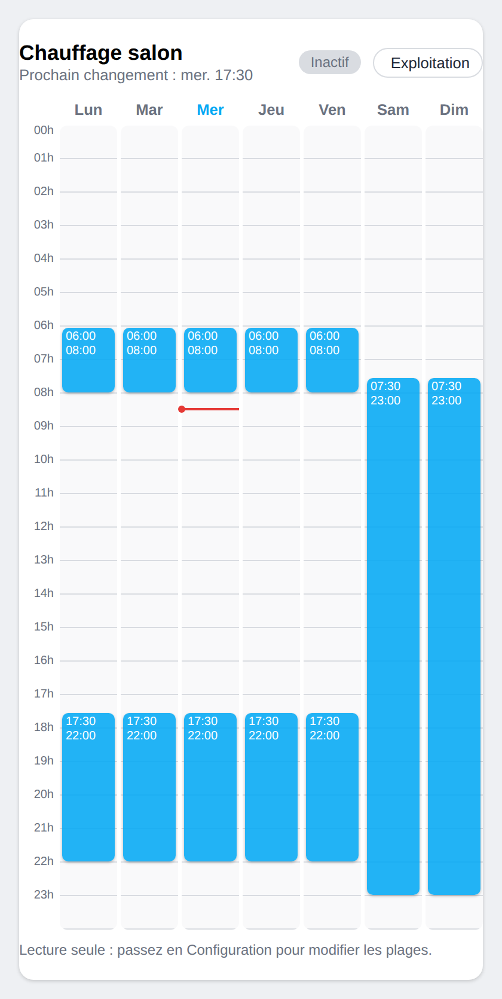
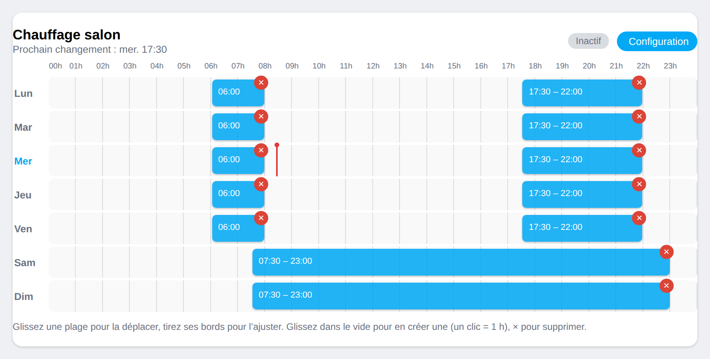

# Planning hebdomadaire pour Home Assistant

[](https://github.com/hacs/integration)

Une carte Lovelace pour **voir et modifier un planning de la semaine** (chauffage, chauffe-eau, éclairage, arrosage…) directement sur le tableau de bord, en glissant les plages horaires à la souris ou au doigt.

Elle s'appuie sur le helper **Planning** (`schedule.xxx`) de Home Assistant : les plages sont donc enregistrées par Home Assistant, et l'entité passe à `on` pendant les plages. Vous pouvez l'utiliser dans vos automatisations comme n'importe quel planning.

| Vertical | Horizontal (mode Configuration) |
| :---: | :---: |
|  |  |

## Fonctionnalités

- Deux cartes : **verticale** (jours en colonnes) et **horizontale** (jours en lignes).
- **Mode Exploitation** (par défaut) : lecture seule, aucune modification possible par erreur.
- **Mode Configuration** (bouton en haut à droite) : déplacer une plage (même vers un autre jour), ajuster ses bords, créer une plage (glisser dans le vide, un clic = 1 h) et la supprimer (×).
- Les plages ne se chevauchent jamais, le glissé se cale sur un pas réglable (15 min par défaut).
- Ligne rouge de l'heure actuelle, jour courant mis en évidence, état Actif / Inactif et prochain changement.
- Éditeur visuel intégré, couleur réglable, et option pour verrouiller totalement la carte.

## Prérequis

1. Un helper **Planning** : *Paramètres → Appareils et services → Entrées → Créer une entrée → Planning*.
2. Un **compte administrateur** pour lire et enregistrer (la carte utilise l'API des helpers Planning). Avec un autre compte, elle affiche un message d'erreur.
3. Un planning créé par l'interface : un planning défini en YAML n'est pas modifiable.
4. La vue **Sections** (Home Assistant 2024.11 ou plus récent) est recommandée pour régler la taille de la carte.

## Installation

### Avec HACS (recommandé)

1. Dans HACS, ouvrez le menu ⋮ puis **Dépôts personnalisés**.
2. Ajoutez `https://github.com/VOTRE-PSEUDO/planning-semaine-card` avec la catégorie **Tableau de bord** (*Dashboard*).
3. Téléchargez **Planning hebdomadaire**, puis rechargez le navigateur (`Ctrl + F5`).

### Manuellement

1. Copiez `planning-semaine-card.js` dans le dossier `config/www/` de Home Assistant.
2. Ajoutez la ressource : *Paramètres → Tableaux de bord → ⋮ → Ressources*, URL `/local/planning-semaine-card.js`, type **Module JavaScript**.
3. Rechargez le navigateur (`Ctrl + F5`).

## Utilisation

Ajoutez la carte depuis l'éditeur de tableau de bord (« Planning hebdomadaire (vertical) » ou « (horizontal) »), ou en YAML :

```yaml
type: custom:planning-semaine-card            # vertical
entity: schedule.chauffage
```

```yaml
type: custom:planning-semaine-horizontal-card # horizontal
entity: schedule.chauffage
grid_options:
  columns: full
```

### Options

| Option | Défaut | Description |
| --- | --- | --- |
| `entity` | *(obligatoire)* | Le helper Planning (`schedule.xxx`). |
| `name` | nom du helper | Titre affiché. |
| `orientation` | selon la carte | `vertical` ou `horizontal` (fonctionne sur les deux cartes). |
| `step` | `15` | Pas du glissé, en minutes. |
| `hour_height` | `28` | Vertical : hauteur d'une heure, en pixels. |
| `row_height` | `40` | Horizontal : hauteur d'une ligne, en pixels. |
| `hour_width` | `18` | Horizontal : largeur minimale d'une heure, en pixels. |
| `color` | `var(--primary-color)` | Couleur des plages (ex. `"#ff9800"`). |
| `hide_config_button` | `false` | `true` : carte en lecture seule (le bouton Configuration disparaît). |

## Bon à savoir

- Une plage peut aller jusqu'à 24:00 mais pas passer minuit : il faut deux plages, comme dans le helper natif.
- **La carte horizontale paraît étroite ?** « Pleine largeur » s'applique à la largeur de la *section*, et une section est limitée à 500 px par défaut. Élargissez la section (`column_span` dans la section, `max_columns` dans la vue) ou utilisez une vue **Panneau**.
- **Rien ne s'affiche après l'installation ?** Videz le cache du navigateur (`Ctrl + F5`), ou dans l'appli mobile *Paramètres → Application compagnon → Dépannage → Réinitialiser le cache du frontend*. Vérifiez aussi que la ressource est bien déclarée (*Tableaux de bord → ⋮ → Ressources*).
- Sur téléphone, en mode Configuration, toucher la zone des jours déclenche la création de plage et bloque le défilement : faites défiler en touchant l'en-tête ou la colonne des heures.

## Licence

[MIT](LICENSE)

---

# English summary

A Lovelace card to **view and edit a weekly schedule** by dragging time ranges. It reads and writes a Home Assistant **Schedule helper** (`schedule.xxx`), so the ranges can be used in automations.

- Two cards: `custom:planning-semaine-card` (vertical) and `custom:planning-semaine-horizontal-card` (horizontal).
- **Operation mode** (default) is read-only. **Configuration mode** lets you move, resize, create and delete ranges.
- Requires an **administrator account** (it uses the Schedule helper websocket API) and a schedule created from the UI (YAML schedules are read-only).
- Install through HACS (custom repository, category *Dashboard*) or copy `planning-semaine-card.js` to `config/www/` and add it as a JavaScript module resource.
- Options: `entity`, `name`, `orientation`, `step`, `hour_height`, `row_height`, `hour_width`, `color`, `hide_config_button` (see the table above).
- "Full width" in the sections view means the full width of the *section* (500 px max by default): widen the section with `column_span`, or use a panel view.
