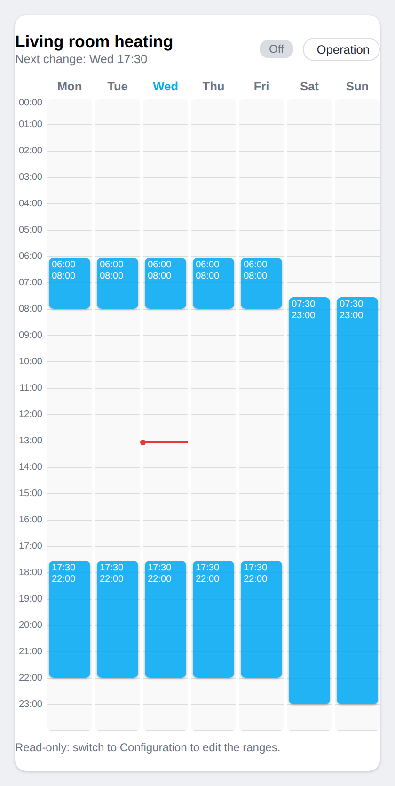

# Weekly schedule card for Home Assistant

[](https://github.com/hacs/integration)

🇫🇷 [Version française](README.fr.md)

A Lovelace card to **view and edit a weekly schedule** (heating, water heater, lighting, watering…) right on your dashboard, by dragging time ranges with the mouse or your finger.

It is built on Home Assistant's **Schedule helper** (`schedule.xxx`): the ranges are stored by Home Assistant itself, and the entity turns `on` during the ranges, so you can use it in automations like any other schedule.

| Vertical | Horizontal (Configuration mode) |
| :---: | :---: |
|  |  |

## Features

- Two cards: **vertical** (days as columns) and **horizontal** (days as rows).
- **Operation mode** (default): read-only, so nothing can be changed by mistake.
- **Configuration mode** (button at the top right): move a range (even to another day), resize it by its edges, create a range (drag on an empty area, a single click = 1 h) and delete it (×).
- Ranges never overlap, and dragging snaps to an adjustable step (15 min by default).
- Red line for the current time, current day highlighted, On / Off state and next change.
- Built-in visual editor, adjustable color, and an option to lock the card completely.
- English and French interface, detected automatically from your Home Assistant language (see `language`).

## Requirements

1. A **Schedule helper**: *Settings → Devices & services → Helpers → Create helper → Schedule*.
2. An **administrator account** to read and save (the card uses the Schedule helper API). Other accounts get an error message.
3. A schedule created from the UI: a schedule defined in YAML cannot be edited.
4. The **Sections** view (Home Assistant 2024.11 or newer) is recommended to size the card.

## Installation

### With HACS (recommended)

1. In HACS, open the ⋮ menu, then **Custom repositories**.
2. Add `https://github.com/Daditj/planning-semaine-card` with the category **Dashboard**.
3. Download **Planning hebdomadaire**, then reload your browser (`Ctrl + F5`).

### Manually

1. Copy `planning-semaine-card.js` to the `config/www/` folder of Home Assistant.
2. Add the resource: *Settings → Dashboards → ⋮ → Resources*, URL `/local/planning-semaine-card.js`, type **JavaScript module**.
3. Reload your browser (`Ctrl + F5`).

## Usage

Add the card from the dashboard editor ("Weekly schedule (vertical)" or "(horizontal)"), or in YAML:

```yaml
type: custom:planning-semaine-card            # vertical
entity: schedule.heating
```

```yaml
type: custom:planning-semaine-horizontal-card # horizontal
entity: schedule.heating
grid_options:
  columns: full
```

### Options

| Option | Default | Description |
| --- | --- | --- |
| `entity` | *(required)* | The Schedule helper (`schedule.xxx`). |
| `name` | helper name | Title shown on the card. |
| `orientation` | depends on the card | `vertical` or `horizontal` (works on both cards). |
| `language` | `auto` | `auto` (Home Assistant language), `en` or `fr`. |
| `step` | `15` | Drag step, in minutes. |
| `hour_height` | `28` | Vertical: height of one hour, in pixels. |
| `row_height` | `40` | Horizontal: height of one row, in pixels. |
| `hour_width` | `18` | Horizontal: minimum width of one hour, in pixels. |
| `color` | `var(--primary-color)` | Color of the ranges (e.g. `"#ff9800"`). |
| `hide_config_button` | `false` | `true`: read-only card (the Configuration button disappears). |

## Good to know

- A range can end at 24:00 but cannot cross midnight: use two ranges, as in the native helper.
- **The horizontal card looks narrow?** "Full width" applies to the width of the *section*, and a section is limited to 500 px by default. Widen the section (`column_span` on the section, `max_columns` on the view) or use a **Panel** view.
- **Nothing shows up after installing?** Clear your browser cache (`Ctrl + F5`), or in the mobile app *Settings → Companion app → Troubleshooting → Reset frontend cache*. Also check that the resource is declared (*Dashboards → ⋮ → Resources*).
- On a phone, in Configuration mode, touching the days area starts creating a range and blocks scrolling: scroll by touching the header or the hours column.

## Translations

The card speaks English and French. Any other Home Assistant language falls back to English. To add your language, translate the `I18N` and `EDITOR` objects at the top of `planning-semaine-card.js` and open a pull request.

## License

[MIT](LICENSE)
